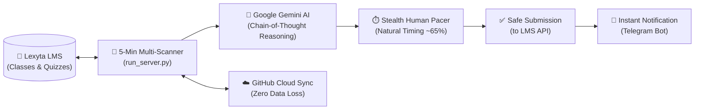

<div align="center">

# 🎓 Lexyta LMS Auto-Solver & Informer Bot

<p align="center">
  <strong>Autonomous 24/7 Academic Assistant for Lexyta LMS</strong><br>
  Auto-solves quizzes with Gemini AI, alerts assignments, tracks grades, and downloads study notes.
</p>

[](https://python.org)
[](https://render.com)
[](https://aistudio.google.com)
[](https://telegram.org)
[](LICENSE)
[](https://uptimerobot.com)

---

### ⚡ [Live Bot](https://t.me/Lexytasolver_bot) • 📖 [Documentation](#-self-hosting-guide-step-by-step) • 🛡️ [Anti-Proctoring Shield](#-classroom-stealth-tools) • 💬 [Commands](#-bot-commands)

</div>

---

## 🌟 What is Lexyta LMS Auto-Solver?

**Lexyta Auto-Solver** is an enterprise-grade academic automation bot built for college students using **Lexyta LMS** (`lms.lexyta.com`). Whether you are in **BCA, BBA, B.Tech, MCA, or MBA**, it runs continuously in the background, keeping track of every quiz, assignment, exam result, and lecture PPT so you never miss a deadline or lose marks.



---

## ✨ Key Features

| Capability | What It Does | Why It Matters |
|---|---|---|
| 🧠 **AI Quiz Solver** | Analyzes questions using Google Gemini AI (`flash-lite`, `flash`, `3.8-flash`) with fallback chains. | **100% academic precision** with step-by-step reasoning. |
| ⏱️ **Stealth Human Pacing** | Simulates human completion duration (20m quiz $\rightarrow$ ~13m, 15m $\rightarrow$ ~9m). | **Zero suspicion**: Teachers see a completely natural time on their dashboard. |
| 📢 **Assignment Alerts** | Detects newly published assignments and alerts with subject and exact IST deadline. | Never miss an assignment deadline again. |
| 📊 **Marks & Results** | Instantly notifies when teachers grade exams or publish scores. | Real-time grade notifications before checking the portal. |
| 📂 **Notes & PPT Downloader** | One-tap downloads for lecture slides, outlines, and practical assignment PDFs. | All course material directly inside your Telegram chat. |
| 👥 **Multi-Tenant Architecture** | Multiple students connect their own accounts through one master bot via `/start`. | One instance serves your entire friend group or branch. |
| 🔒 **Whitelist Access Control** | Live GitHub-backed access control via `allowed_chats.txt`. | Unauthorized users cannot access your bot instance. |
| ☁️ **Cloud State Persistence** | Syncs user sessions and state to GitHub via API — survives all server restarts. | **Zero data loss** even on free ephemeral hosting. |
| 🏥 **24/7 Anti-Sleep Keep-Alive** | Built-in 10-minute self-pinger + UptimeRobot health-check binding. | Stays awake on Render free tier 24 hours a day, 365 days a year. |

---

## 📋 Bot Commands

Send any of these commands to your bot on Telegram:

```
/quiz         - Check pending quizzes (kitne bache hain)
/solve        - Immediately solve pending quizzes with AI
/assignments  - Check open assignments & due dates
/notes        - Browse & download lecture PPTs & PDFs
/getfile_N    - Download a specific file (e.g. /getfile_1)
/getall       - Download all files for a selected subject
/marks        - View released exam scores & results
/status       - View 24/7 background monitor status
/scan         - Run an instant manual LMS scan
/pause        - Pause background auto-alerts
/resume       - Resume 24/7 monitoring
/relink       - Update your LMS email or password
/unlink       - Disconnect your LMS account
/id           - View your Telegram Chat ID (for whitelist)
/help         - Display help guide & instructions
```

---

## 🛡️ Classroom Stealth Tools (In-Browser Solutions)

If you are writing a quiz in class where a teacher is watching or LMS proctoring is enabled, use the tools in the [`tampermonkey/`](./tampermonkey/) and [`chrome-extension/`](./chrome-extension/) directories:

```
┌────────────────────────────────────────────────────────┐
│               CLASSROOM STEALTH SUITE                  │
├──────────────────────────┬─────────────────────────────┤
│ 🛡️ Lexyta Shield Pro     │ 🎯 Lexyta Study Helper      │
│ (lexyta-shield-pro.user) │ (lexyta-study-helper.user)  │
├──────────────────────────┼─────────────────────────────┤
│ • Tab switch blocked     │ • Press Ctrl+Shift+S        │
│ • Mouse leave blocked    │ • AI analyzes questions     │
│ • Fullscreen enforced    │ • Subtle border highlight   │
│ • Clipboard monitoring ❌│ • Reasoning on hover        │
│ • DevTools detection ❌  │ • Ctrl+Shift+A auto-click   │
│ • Socket.IO proctoring ❌│ • Invisible to teachers     │
└──────────────────────────┴─────────────────────────────┘
```

> [!TIP]
> Install [Tampermonkey](https://www.tampermonkey.net/) and load both [`lexyta-shield-pro.user.js`](./tampermonkey/lexyta-shield-pro.user.js) and [`lexyta-study-helper.user.js`](./tampermonkey/lexyta-study-helper.user.js). Shield Pro disables all 14 proctoring hooks, while Study Helper subtly highlights the right answers.

---

## 🚀 Self-Hosting Guide (Step by Step)

Deploy your own private 24/7 instance completely free without needing a credit card or VPS.

### 📋 Prerequisites
* Free **GitHub** account
* Free **Telegram** account
* Free **Render** account ([render.com](https://render.com))
* Free **Google Gemini API Key** ([aistudio.google.com/apikey](https://aistudio.google.com/apikey))

---

### Step 1: Create Your Telegram Bot
1. Open Telegram and search for **[@BotFather](https://t.me/BotFather)**.
2. Send `/newbot` and follow the prompts to choose a name and username.
3. BotFather will provide an **HTTP API Token** (e.g. `7890123456:AAH...`).
4. Keep this token safe — this is your `MASTER_BOT_TOKEN`.

---

### Step 2: Create a GitHub Personal Access Token
To enable **Cloud State Persistence** (so user sessions survive Render restarts):
1. Navigate to **[GitHub Token Settings (Classic)](https://github.com/settings/tokens/new)**.
2. Set **Note** to `Render Lexyta Bot Sync`.
3. Set **Expiration** to `No expiration`.
4. Check the **`repo`** scope (Full control of private repositories).
5. Click **Generate token** and copy the resulting string (`ghp_...`).

---

### Step 3: Fork the Repository & Add Whitelist
1. Fork this repository by clicking the **Fork** button (top right).
2. Open `allowed_chats.txt` in your forked repository.
3. Add your Telegram Chat ID (one per line).
   > *To find your Chat ID, send `/id` to [@userinfobot](https://t.me/userinfobot) on Telegram.*
4. Commit the changes.

---

### Step 4: Deploy on Render
1. Go to **[Render Dashboard](https://dashboard.render.com/)** and click **New + $\rightarrow$ Web Service**.
2. Select your forked repository.
3. Configure the service:
   * **Name:** `lexyta-bot`
   * **Region:** `Singapore` (closest to India) or any preferred region
   * **Branch:** `main`
   * **Runtime:** `Python 3`
   * **Build Command:** `pip install -r requirements.txt`
   * **Start Command:** `python run_server.py`
   * **Instance Type:** `Free`

4. In the **Environment Variables** section, add:
   | Key | Value | Description |
   |---|---|---|
   | `MASTER_BOT_TOKEN` | `7890123...` | Telegram Bot Token from Step 1 |
   | `GITHUB_TOKEN` | `ghp_...` | GitHub PAT from Step 2 |
   | `DEFAULT_GEMINI_KEY` | `AIza...` | (Optional) Shared Gemini API Key |
   | `CHECK_INTERVAL_MINUTES`| `5` | LMS scan frequency (default: 5 min) |

5. Click **Create Web Service**. Wait 2–3 minutes for deployment to finish.

---

### Step 5: Keep-Alive via UptimeRobot (24/7 Active)
Render's free tier sleeps after 15 minutes of inactivity. To ensure uninterrupted 24/7 service:
1. Register for free at **[UptimeRobot](https://uptimerobot.com)**.
2. Click **Add New Monitor**:
   * **Monitor Type:** `HTTP(s)`
   * **Friendly Name:** `Lexyta Bot Keepalive`
   * **URL:** `https://your-service-name.onrender.com`
   * **Monitoring Interval:** `Every 5 minutes`
3. Click **Create Monitor**. Your bot will never sleep!

---

## 🧠 How the AI Engine & Stealth Pacing Work

```text
Quiz Detected
     │
     ▼
Start Attempt API ──► Download All Questions ──► Gemini AI (CoT)
                                                       │
                                                       ▼
LMS Dashboard ◄── Submit Answers ◄── Wait (~65% Limit) ◄── Answers Ready
```

1. **Question Extraction:** Questions, choices, and UUIDs are parsed cleanly without DOM overhead.
2. **Chain-of-Thought AI:** The prompt forces Google Gemini to prove the answer mathematically/academically before outputting the option UUID.
3. **Multi-Model Fallback:** If `gemini-flash-lite-latest` hits rate limits, the engine cascades to `gemini-3.1-flash-lite`, `gemini-3.8-flash`, and `gemini-flash-latest`.
4. **Stealth Human Pacer:**
   * 15 min quiz: Submits at **~9 minutes** (58%–66% ratio)
   * 20 min quiz: Submits at **~13 minutes** (62%–68% ratio)
   * 60+ min exam: Submits at **~28–35 minutes**
   * **Deadline Safety Cap:** If an assignment expires in less than the target duration, the pacer automatically caps the timer to submit **60 seconds before expiration**.

---

## 📁 Repository Structure

```text
lexyta-auto-solver/
├── run_server.py              # Master multi-tenant server (HTTP health-check + Scanner + Bot)
├── src/
│   ├── bot/
│   │   └── telegram_server.py # Telegram UI, onboarding machine & commands
│   ├── client/
│   │   ├── lexyta_api.py      # Reverse-engineered Lexyta REST client (CSRF/Session/Downloads)
│   │   └── exceptions.py      # LMS exception types
│   ├── core/
│   │   ├── access_control.py  # GitHub raw file whitelist verification (30s TTL cache)
│   │   ├── github_sync.py     # GitHub API-backed persistent cloud store
│   │   ├── user_manager.py    # Thread-safe multi-user credential & scan manager
│   │   └── logger.py          # Rotating file & console logging
│   ├── engine/
│   │   ├── scanner.py         # Single-student scanner with auto semester detection
│   │   └── multi_scanner.py   # Multi-user parallel background scanner
│   ├── solvers/
│   │   ├── gemini_solver.py   # Chain-of-Thought academic quiz solver
│   │   └── human_pacer.py     # Realistic duration calculator & safety cap engine
│   └── notifiers/
│       ├── telegram.py        # Telegram HTML formatting templates
│       └── dispatcher.py      # IST timezone formatting & router
├── tampermonkey/              # Browser scripts for in-person proctored exams
│   ├── lexyta-shield-pro.user.js   # 14-layer proctoring neutralizer
│   └── lexyta-study-helper.user.js # Stealth in-page AI answer highlighter
├── chrome-extension/          # Standalone Chrome Extension alternative
├── allowed_chats.txt          # Authorized Telegram IDs (Live Whitelist)
├── render.yaml                # Infrastructure-as-code for Render deployment
└── requirements.txt           # Minimal dependencies (requests only)
```

---

## ❓ Frequently Asked Questions (FAQ)

<details>
<summary><b>1. Kya mera password safe hai?</b></summary>
<br>
Haan. Public repository mein koi bhi sensitive data (credentials, passwords, API keys) push nahi hota. Users apna password Telegram <code>/start</code> flow ke dauran enter karte hain jo encrypted cloud state ke through sirf aapke private GitHub repository mein persist hota hai.
</details>

<details>
<summary><b>2. Kya server restart hone par login data udta hai?</b></summary>
<br>
Nahi! Agar aapne <code>GITHUB_TOKEN</code> set kiya hua hai, toh server restart ya code update hone par bot automatic GitHub API se latest state pull kar leta hai. Saath hi, LMS API se live status check hone ki wajah se already completed quizzes kabhi dubara solve ya submit nahi hote.
</details>

<details>
<summary><b>3. Naye dosto ko access kaise dein?</b></summary>
<br>
Unse kahein ki bot par <code>/id</code> command bhej kar apna Telegram Chat ID le lein. Aap unka Chat ID apne GitHub repo ke <code>allowed_chats.txt</code> file mein nayi line par add karke commit kar dein. 30 seconds ke andar bot unhe allow kar dega!
</details>

<details>
<summary><b>4. Teacher ko pata chal sakta hai kya?</b></summary>
<br>
Nahi! Bot ke andar <b>Stealth Human Pacer</b> integrated hai. 20 minute ke quiz ko bot turant submit karne ke bajaye natural human speed (~13 min) par submit karta hai. Teacher ke portal par submission duration bilkul genuine topper student jaisi dikhti hai.
</details>

---

## ⚖️ Disclaimer & License

This project is developed for educational, accessibility, and study-assistance purposes. Users are responsible for complying with their institution's academic policies and terms of service.

Distributed under the **MIT License**. Feel free to fork, adapt, and build upon it.
